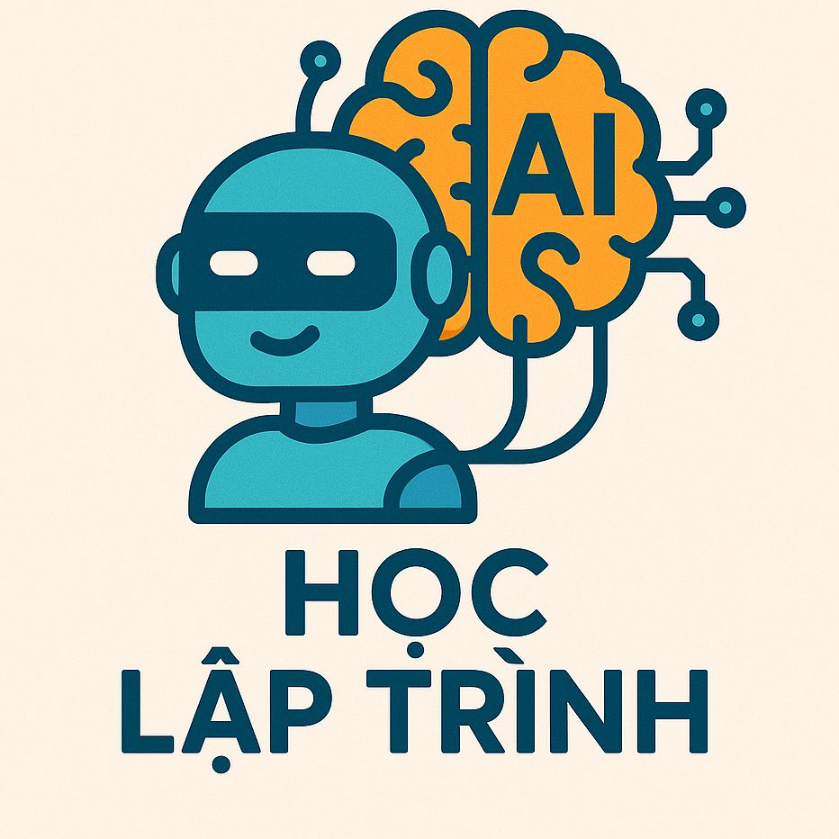
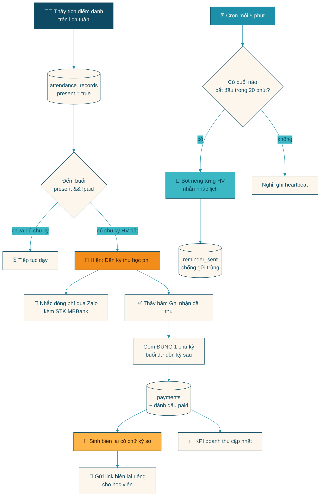
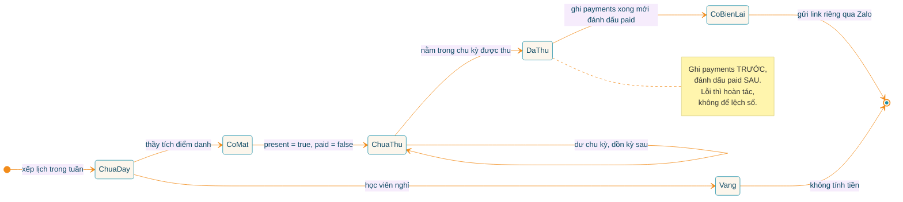
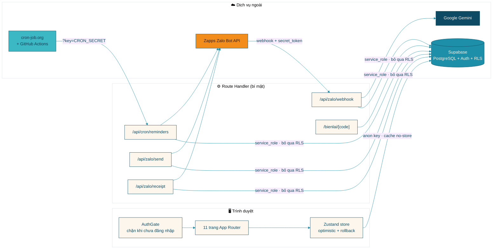
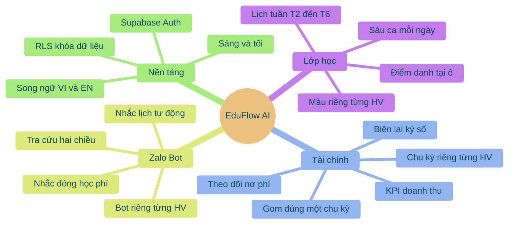
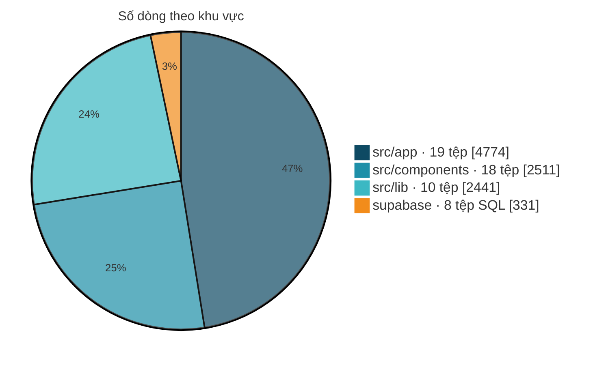
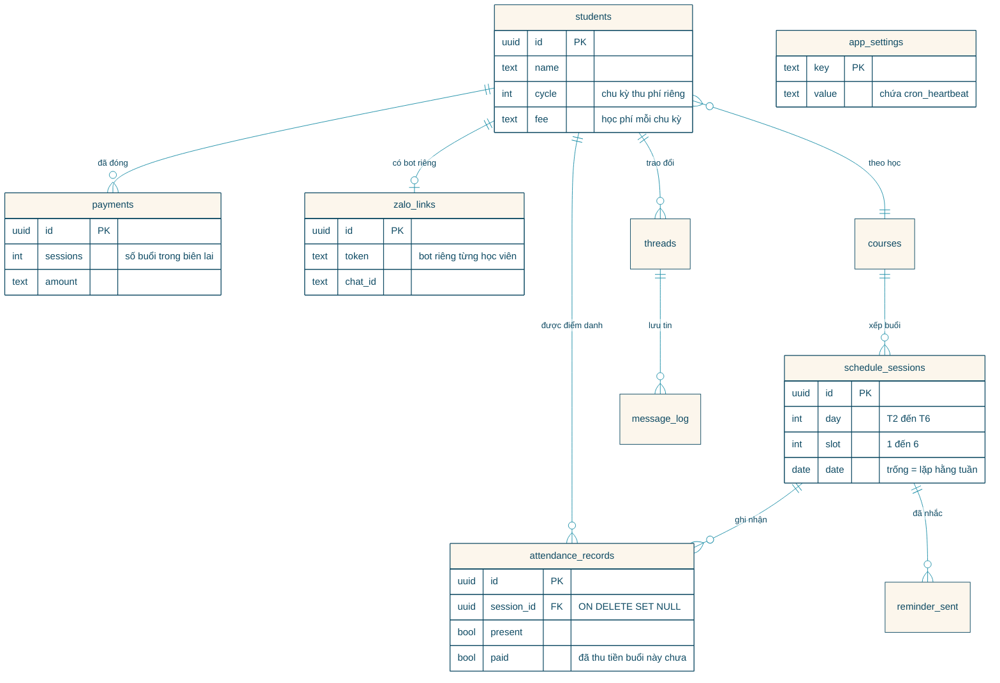
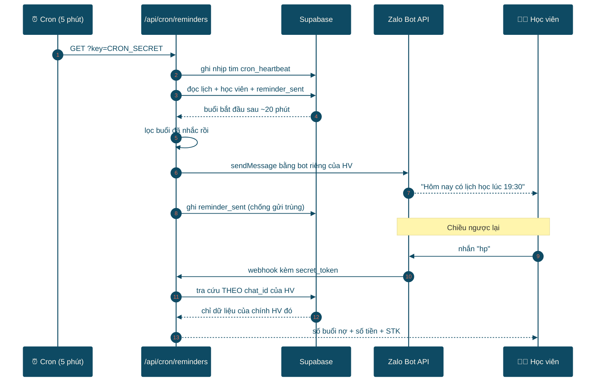

<div align="center">



<br/>



# EduFlow AI

**Hệ thống quản lý lớp học của AI Học Lập Trình — điểm danh trên lịch tuần, tự động tính đúng chu kỳ học phí của từng học viên, xuất biên lai riêng và nhắc lịch qua Zalo Bot mà không cần ai bấm tay.**

<br/>

[](#tính-năng-chính)
[](https://nextjs.org)
[](https://supabase.com)
[](#zalo-bot-và-trợ-lý-ai)

[](https://www.typescriptlang.org)
[](https://react.dev)
[](https://tailwindcss.com)
[](https://zustand-demo.pmnd.rs)
[](https://ai.google.dev)
[](LICENSE)

</div>

<br/>

> [!IMPORTANT]
> **Bản quyền thuộc về Trương Tấn Nghĩa (AI Học Lập Trình).** Kho mã này để **công khai nhằm mục đích trưng bày năng lực**, **không phải mã nguồn mở**.
> Việc xem được mã **không đồng nghĩa với việc được cấp phép sử dụng**. Vui lòng không sao chép, tái sử dụng, phân phối lại hay thương mại hóa khi chưa có văn bản đồng ý. Chi tiết xem [`LICENSE`](LICENSE).

<br/>

## Mục lục

| | | |
|:--|:--|:--|
| 🎯 [Tính năng chính](#tính-năng-chính) | 🔄 [Luồng hoạt động](#luồng-hoạt-động) | 🏗️ [Kiến trúc hệ thống](#kiến-trúc-hệ-thống) |
| 🗄️ [Cơ sở dữ liệu](#cơ-sở-dữ-liệu) | 🤖 [Zalo Bot và trợ lý AI](#zalo-bot-và-trợ-lý-ai) | ⚙️ [Cài đặt](#cài-đặt) |
| 🩺 [Vận hành và kiểm tra](#vận-hành-và-kiểm-tra) | 📂 [Cấu trúc thư mục](#cấu-trúc-thư-mục) | ✍️ [Tác giả](#tác-giả) |

<br/>

## Tính năng chính

<table>
<tr>
<td width="33%" valign="top">

### 📅 Lịch tuần có màu riêng

Lưới **T2–T6 × 6 ca**, mỗi học viên được cấp **một màu không trùng với ai**, hiển thị **tên gọi** thay vì họ để nhìn phát biết ngay. Điểm danh ngay trên ô lịch.

</td>
<td width="33%" valign="top">

### 💰 Học phí theo chu kỳ

Mỗi học viên tự đặt chu kỳ riêng (**8 buổi, 10 buổi…**). Thu tiền chỉ gom **đúng một chu kỳ**, buổi dư **tự dồn sang kỳ sau** chứ không gộp bừa.

</td>
<td width="33%" valign="top">

### 🧾 Biên lai riêng tư

Mỗi lần thu tạo một **trang biên lai HTML** có hiệu ứng động, địa chỉ được **ký số** nên **ai mở được của người đó**, lưu lại để xem về sau.

</td>
</tr>
<tr>
<td width="33%" valign="top">

### 🔔 Nhắc lịch tự động

Cron gọi mỗi 5 phút, tìm buổi sắp diễn ra trong **~20 phút tới** rồi nhắn qua **bot Zalo riêng của từng học viên**, có **chống gửi trùng**.

</td>
<td width="33%" valign="top">

### 🤖 Bot hỏi đáp hai chiều

Thầy nhắn bot để tra lịch, học phí, điểm danh. **Học viên nhắn bot của mình chỉ thấy đúng dữ liệu của mình.** Câu ngoài lệnh thì **Gemini** trả lời.

</td>
<td width="33%" valign="top">

### 🔐 Khóa một tài khoản

Đăng nhập bằng **Supabase Auth**, RLS chỉ mở cho `authenticated`. Không đăng nhập thì **không đọc được một dòng dữ liệu nào**.

</td>
</tr>
</table>

<br/>

## Luồng hoạt động



Toàn bộ nghiệp vụ chỉ bắt đầu từ **một thao tác duy nhất: tích điểm danh**. Mọi thứ phía sau tự chạy.



<br/>

### Vòng đời một buổi học

Một buổi học đi qua đúng 5 trạng thái — không có đường tắt, nên không bao giờ xảy ra chuyện “đã thu tiền mà không có biên lai”.



<br/>

## Kiến trúc hệ thống

Ứng dụng chạy **100% trên Next.js App Router**. Giao diện nói chuyện thẳng với Supabase bằng khóa công khai; còn những việc cần bí mật — gửi Zalo, chạy cron, gọi Gemini — đều nằm sau **Route Handler phía máy chủ**, nên token không bao giờ lộ ra trình duyệt.



<br/>

<table>
<tr>
<td width="50%" valign="top">

**Bản đồ tính năng**



</td>
<td width="50%" valign="top">

**Phân bổ mã nguồn** (55 tệp · ~10.000 dòng)



Phần lớn khối lượng nằm ở `src/app` vì ba tệp xử lý nền nặng nhất đều ở đó: cron nhắc lịch (744 dòng), webhook Zalo (523 dòng) và trang biên lai (170 dòng).

</td>
</tr>
</table>

<br/>

<details>
<summary><b>📋 Bảng công nghệ chi tiết — bấm để mở</b></summary>

<br/>

| Lớp | Công nghệ | Phiên bản | Dùng để làm gì trong dự án |
|:--|:--|:--|:--|
| Khung | Next.js (App Router, Turbopack) | `16.2.11` | 11 trang + 6 route handler phía máy chủ |
| Giao diện | React | `19.2.4` | Toàn bộ thành phần hiển thị |
| Kiểu dáng | Tailwind CSS | `v4` | Design token trong `globals.css`, sáng/tối |
| Ngôn ngữ | TypeScript | `5` | Toàn bộ mã, kiểu dữ liệu ở `src/lib/types.ts` |
| Trạng thái | Zustand | `5.0.14` | `useApp` — cập nhật lạc quan rồi đồng bộ Supabase |
| Dữ liệu | `@supabase/supabase-js` | `2.110.8` | PostgreSQL + Auth + RLS |
| Biểu tượng | `lucide-react` | `1.25.0` | Biểu tượng toàn ứng dụng |
| Phông chữ | `geist` | `1.7.2` | Phông chính |
| Nhắn tin | Zapps Zalo Bot API | — | `getMe`, `sendMessage`, `setWebhook`, `getUpdates` |
| Trợ lý | Google Gemini | — | Chuỗi dự phòng 5 mô hình, tự chuyển khi quá tải |

</details>

<details>
<summary><b>🔌 Danh sách Route Handler — bấm để mở</b></summary>

<br/>

| Đường dẫn | Dòng | Nhiệm vụ |
|:--|--:|:--|
| [`/api/cron/reminders`](src/app/api/cron/reminders/route.ts) | 744 | Trái tim của hệ thống: quét buổi sắp tới, gửi nhắc lịch, gửi bản tổng hợp học phí cho thầy, ghi nhịp tim, kèm **9 công cụ chẩn đoán** |
| [`/api/zalo/webhook`](src/app/api/zalo/webhook/route.ts) | 523 | Nhận tin nhắn Zalo, phân biệt thầy / học viên, trả lời lệnh hoặc chuyển cho Gemini |
| [`/bienlai/[code]`](src/app/bienlai/[code]/route.ts) | 170 | Trả về trang biên lai HTML động, bỏ qua lớp đăng nhập, xác thực bằng chữ ký số |
| [`/api/zalo/receipt`](src/app/api/zalo/receipt/route.ts) | — | Gửi link biên lai cho đúng một học viên |
| [`/api/zalo/send`](src/app/api/zalo/send/route.ts) | — | Gửi tin nhắn Zalo, giữ token ở phía máy chủ |
| [`/api/zalo/updates`](src/app/api/zalo/updates/route.ts) | — | Lấy `chat_id` khi mới liên kết bot cho học viên |

</details>

<details>
<summary><b>🧠 Các mô-đun nghiệp vụ trong <code>src/lib</code> — bấm để mở</b></summary>

<br/>

| Tệp | Dòng | Nội dung cốt lõi |
|:--|--:|:--|
| [`store.ts`](src/lib/store.ts) | 999 | Kho Zustand `useApp`: toàn bộ CRUD, `recordPayment` chặn thu quá chu kỳ, `refreshData` đồng bộ nền, `sendTuitionBill`, `sendReceipt`, `registerStudentBots` |
| [`reminders.ts`](src/lib/reminders.ts) | 334 | `dueReminders`, `buildTuitionReminders`, `buildAttendanceAlerts`, `dueSessionAlerts` — tính theo giờ Việt Nam (UTC+7) |
| [`derived.ts`](src/lib/derived.ts) | 239 | `tuitionProgress`, `unpaidSessions`, `revenueByCourse`, `buildTuitionMessage`, thông tin ngân hàng |
| [`receipt.ts`](src/lib/receipt.ts) | — | `receiptSig` ký địa chỉ biên lai, `receiptUrl`, `buildReceiptMessage` |
| [`gemini.ts`](src/lib/gemini.ts) | — | `askGemini` với chuỗi 5 mô hình dự phòng, tự nhảy mô hình khi gặp lỗi 503 |
| [`supabase.ts`](src/lib/supabase.ts) | — | Khởi tạo client, **ép `cache: "no-store"`** để trình duyệt không hiển thị dữ liệu cũ |
| [`i18n.ts`](src/lib/i18n.ts) | — | Từ điển song ngữ VI / EN |
| [`subjects.ts`](src/lib/subjects.ts) | — | Bảng màu môn học và màu đại diện học viên |
| [`seed.ts`](src/lib/seed.ts) | — | Dữ liệu mẫu, chỉ dùng khi **chưa** cấu hình Supabase |

</details>

<br/>

## Cơ sở dữ liệu

**10 bảng PostgreSQL** trên Supabase, toàn bộ đã bật Row Level Security.



> [!NOTE]
> **Hai quyết định thiết kế đáng chú ý.**
> **Một:** khóa ngoại từ `attendance_records` sang `schedule_sessions` dùng `ON DELETE SET NULL` chứ không phải `CASCADE` — xóa một buổi trong lịch sẽ **không** cuốn theo lịch sử điểm danh.
> **Hai:** buổi chưa thu tiền được xác định bằng `present && !paid`, nên việc dạy và việc thu tiền hoàn toàn độc lập, xóa lịch sử điểm danh rồi làm lại cũng không mất sổ tiền.

<details>
<summary><b>🗂️ 8 tệp SQL trong <code>supabase/</code> — bấm để mở</b></summary>

<br/>

| Tệp | Chạy khi nào |
|:--|:--|
| [`schema.sql`](supabase/schema.sql) | **Chạy đầu tiên** cho dự án mới: tạo 10 bảng, bật RLS, nạp dữ liệu mẫu |
| [`migration_auth_lockdown.sql`](supabase/migration_auth_lockdown.sql) | **Chạy sau khi đã tạo tài khoản admin**: gỡ quyền của khách, chỉ cho tài khoản đã đăng nhập đọc ghi |
| [`migration_tuition_cycle.sql`](supabase/migration_tuition_cycle.sql) | Thêm chu kỳ học phí riêng cho từng học viên |
| [`migration_attendance.sql`](supabase/migration_attendance.sql) | Thêm bảng điểm danh |
| [`migration_attendance_keep.sql`](supabase/migration_attendance_keep.sql) | Đổi khóa ngoại sang `ON DELETE SET NULL` để giữ lịch sử điểm danh |
| [`migration_reminders.sql`](supabase/migration_reminders.sql) | Thêm cột `date` và bảng `reminder_sent` |
| [`migration_schedule.sql`](supabase/migration_schedule.sql) | Bổ sung trường cho lịch học |
| [`migration_courses.sql`](supabase/migration_courses.sql) | Bổ sung trường cho khóa học |

</details>

<br/>

## Zalo Bot và trợ lý AI

Thầy có bot riêng, **mỗi học viên cũng có bot riêng**. Hệ thống nhận ra người nhắn bằng `chat_id`, nên học viên **chỉ thấy đúng dữ liệu của mình**, không bao giờ nhìn được của bạn khác.



### Lệnh nhắn cho bot

<table>
<tr>
<td width="50%" valign="top">

**👩‍🏫 Bot của thầy**

| Gõ | Nhận lại |
|:--|:--|
| `lich` | Lịch dạy hôm nay |
| `tuan` | Lịch cả tuần |
| `hp` | Học viên đến kỳ thu, kèm số tiền |
| `hv` | Danh sách học viên |
| `dd` | Tình hình điểm danh |
| `kt` | **Kiểm tra sức khỏe dữ liệu** |
| `menu` | Danh sách lệnh |
| *câu bất kỳ* | **Gemini trả lời** |

</td>
<td width="50%" valign="top">

**🧑‍🎓 Bot của học viên**

| Gõ | Nhận lại |
|:--|:--|
| `lich` | Lịch học hôm nay **của mình** |
| `tuan` | Lịch tuần **của mình** |
| `hp` | Học phí còn nợ **của mình** |
| `bh` | Số buổi đã học **của mình** |

> [!WARNING]
> Học viên **không** truy cập được dữ liệu của người khác. Mọi truy vấn đều bị ràng buộc theo `chat_id` trước khi chạm vào cơ sở dữ liệu.

</td>
</tr>
</table>

<br/>

## Cài đặt

### 1. Chạy thử ngay trên máy (Windows · PowerShell)

```powershell
git clone https://github.com/TruongTanNghia/Project-Classroom-Management.git
cd Project-Classroom-Management
npm install
npm run dev
```

Mở `http://localhost:3000`. **Chưa cần cấu hình gì cả** — không có `.env.local` thì ứng dụng tự chạy ở **chế độ demo** với dữ liệu mẫu trong bộ nhớ.

> [!TIP]
> Máy có phần mềm VPN chiếm cổng 3000 (ví dụ EonVPN) thì đổi cổng: `npx next dev -p 3001`

### 2. Kết nối Supabase thật

1. Tạo dự án miễn phí tại [supabase.com](https://supabase.com).
2. Vào **SQL Editor** → dán toàn bộ [`supabase/schema.sql`](supabase/schema.sql) → **Run**. Lệnh này tạo 10 bảng và bật RLS.
3. Tạo tệp `.env.local` từ mẫu [`.env.local.example`](.env.local.example):

```ini
# Bắt buộc — lấy ở Project Settings → API
NEXT_PUBLIC_SUPABASE_URL=https://xxxx.supabase.co
NEXT_PUBLIC_SUPABASE_PUBLISHABLE_KEY=sb_publishable_xxxx

# Chỉ chạy phía máy chủ — TUYỆT ĐỐI không thêm tiền tố NEXT_PUBLIC_
SUPABASE_SERVICE_ROLE_KEY=sb_secret_xxxx
ZALO_BOT_TOKEN=xxxxxxxxxxxxxxxxxxx:xxxxxxxx
CRON_SECRET=mot-chuoi-ngau-nhien-tu-dat
GEMINI_API_KEY=xxxxxxxxxxxxxxxxxxxx
```

4. Khởi động lại `npm run dev`. Từ lúc này mọi thao tác thêm, sửa, xóa, điểm danh, thu học phí đều ghi thẳng xuống Supabase.

### 3. Khóa lại, chỉ mình thầy vào được

> [!WARNING]
> **Thứ tự này bắt buộc.** Chạy bước 3 trước bước 2 sẽ làm ứng dụng trắng trơn vì không còn quyền đọc dữ liệu.

1. Supabase → **Authentication** → **Providers** → bật **Email**.
2. **Authentication** → **Users** → **Add user**: tạo **một** tài khoản admin duy nhất (nhớ bật *Auto Confirm User*).
3. **SQL Editor** → chạy [`supabase/migration_auth_lockdown.sql`](supabase/migration_auth_lockdown.sql).
4. Mở lại ứng dụng → đăng nhập bằng tài khoản vừa tạo.

Sau bước này, RLS chỉ còn mở cho vai trò `authenticated`. Các route nền vẫn chạy bình thường vì chúng dùng `SUPABASE_SERVICE_ROLE_KEY` để bỏ qua RLS.

### 4. Bật nhắc lịch tự động

1. Đưa dự án lên [Vercel](https://vercel.com/new), khai báo **đủ 6 biến môi trường** ở mục *Environment Variables*.
2. Tạo tài khoản miễn phí tại [cron-job.org](https://cron-job.org) → tạo job:
   - **URL:** `https://<ten-app>.vercel.app/api/cron/reminders?key=<CRON_SECRET>`
   - **Lịch chạy:** mỗi **5 phút**
3. Tệp [`.github/workflows/reminders.yml`](.github/workflows/reminders.yml) là **đường dự phòng**, không phải đường chính.

> [!WARNING]
> GitHub Actions **không** chạy đúng mỗi 5 phút như khai báo — thực tế có thể giãn ra **2–3 tiếng** một lần. Chỉ dùng làm dự phòng. Gói Vercel Free cũng chỉ cho cron **một lần mỗi ngày**, không đủ dùng.

<br/>

## Vận hành và kiểm tra

Cron route có sẵn **9 công cụ chẩn đoán**, gọi trực tiếp bằng trình duyệt. Tất cả đều cần `?key=<CRON_SECRET>`.

| Gọi thêm tham số | Việc nó làm |
|:--|:--|
| `&inspect=1` | Xem nhịp tim cron, biết **cron có còn sống hay đã chết** |
| `&dry=1` | Xem trước sẽ gửi gì, **không gửi thật** |
| `&selftest=1` | Chạy thử toàn bộ thao tác ghi dữ liệu rồi dọn sạch |
| `&audit=1` | Soát toàn bộ cơ sở dữ liệu, tìm bản ghi trùng, lệch, mồ côi |
| `&fixdata=1` | **Xem** những gì sẽ được sửa — thêm `&apply=1` mới thật sự sửa |
| `&checkfk=1` | Xác nhận khóa ngoại đã ở chế độ `SET NULL` |
| `&probe=1` | Kiểm tra bot Zalo có gửi tin thật được không |
| `&setupbots=1` | Đăng ký webhook cho tất cả bot học viên |
| `&demo=tuition` | Gửi thử bản mẫu về **bot của thầy** trước khi gửi học viên |

> [!TIP]
> **Thói quen tốt mỗi sáng:** mở `?key=...&inspect=1` xem nhịp tim. Nếu `cronAlive` là `false` nghĩa là dịch vụ cron bên ngoài đã chết — vào cron-job.org bật lại. Hoặc nhanh hơn: nhắn `kt` cho bot của thầy.

> [!NOTE]
> **Chống mất dữ liệu.** Trình duyệt từng lưu đệm phản hồi của Supabase khiến màn hình hiện bản cũ, trông như vừa mất dữ liệu. Nay `src/lib/supabase.ts` ép `cache: "no-store"`, màn hình tự đồng bộ lại mỗi khi quay lại tab và sau mỗi lần ghi, kèm nút làm mới thủ công. Khi ghi thất bại, ứng dụng hiện cảnh báo **“⚠️ CHƯA LƯU ĐƯỢC”** thay vì im lặng.

<br/>

## Cấu trúc thư mục

```
📦 Project-Classroom-Management
├── 📂 src
│   ├── 📂 app                        # 11 trang + 6 route handler
│   │   ├── 📄 page.tsx               # 🏠 Trang chủ
│   │   ├── 📂 dashboard              # 📊 Tổng quan, KPI
│   │   ├── 📂 students               # 👥 Học viên, chu kỳ học phí
│   │   ├── 📂 courses                # 📚 Khóa học
│   │   ├── 📂 schedule               # 📅 Lịch tuần, màu riêng, điểm danh
│   │   ├── 📂 tuition                # 💰 Thu học phí, doanh thu, nợ
│   │   ├── 📂 zalobot                # 🤖 Liên kết bot từng học viên
│   │   ├── 📂 messages               # 💬 Nhật ký tin nhắn
│   │   ├── 📂 insights               # ✨ Phân tích AI (đang tạm ẩn)
│   │   ├── 📂 settings               # ⚙️ Cài đặt
│   │   ├── 📂 about                  # 🪪 Giới thiệu
│   │   ├── 📂 bienlai/[code]         # 🧾 Biên lai HTML có chữ ký số
│   │   └── 📂 api
│   │       ├── 📂 cron/reminders     # ⏰ Nhắc lịch + 9 công cụ chẩn đoán
│   │       └── 📂 zalo               # 📨 webhook · send · receipt · updates
│   ├── 📂 components
│   │   ├── 📂 shell                  # AppShell, AuthGate, Sidebar, Topbar
│   │   ├── 📂 modals                 # 10 hộp thoại CRUD và điểm danh
│   │   └── 📂 ui                     # Thành phần dùng chung
│   └── 📂 lib                        # 🧠 Toàn bộ logic nghiệp vụ
├── 📂 supabase                       # 🗄️ schema.sql + 7 migration
├── 📂 assets                         # 🎨 Ảnh động và logo cho README
├── 📂 .github/workflows              # 🔁 Cron dự phòng
└── 📄 .env.local.example             # 🔑 Mẫu biến môi trường
```

### Trạng thái từng phần

| Thành phần | Trạng thái | Ghi chú |
|:--|:--|:--|
| Lịch tuần và điểm danh |  | Màu riêng từng học viên, hiển thị tên gọi |
| Học phí theo chu kỳ |  | Gom đúng chu kỳ, dư dồn kỳ sau |
| Biên lai ký số |  | Riêng tư theo từng người |
| Nhắc lịch tự động |  | Phụ thuộc cron ngoài, có nhịp tim theo dõi |
| Bot hai chiều + Gemini |  | Thầy và học viên tách quyền |
| Đăng nhập và khóa RLS |  | Một tài khoản admin duy nhất |
| Song ngữ VI / EN · sáng tối |  | Lưu ở `localStorage` |
| Phân tích AI |  | Trang `insights` đang tạm ẩn khỏi thanh bên |
| Giao diện cho học viên |  | Hiện học viên chỉ tương tác qua Zalo Bot |

<br/>

---

<div align="center">

## Tác giả


### Trương Tấn Nghĩa

**AI Học Lập Trình**

*🔥 Never give up 🔥*

<br/>

[](https://github.com/TruongTanNghia)
[](https://nghia-dev-profile.vercel.app)
[](https://www.tiktok.com/@aihoclaptrinh)

<br/>


<br/>

**© 2026 Trương Tấn Nghĩa · AI Học Lập Trình**

*Mọi quyền được bảo lưu — xem [`LICENSE`](LICENSE)*

</div>
